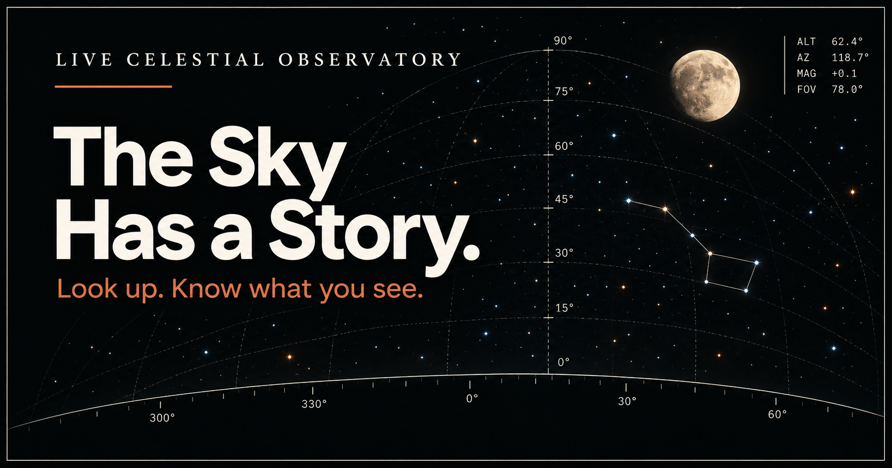
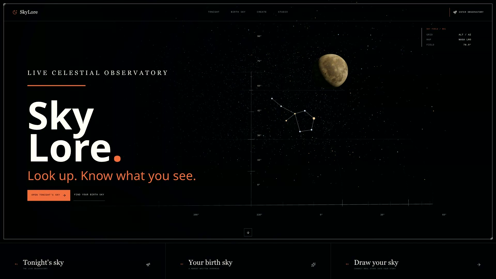

<div align="center">
  <a href="https://skylore-vert.vercel.app">
    
  </a>

  <h1>SkyLore</h1>
  <p><strong>The night sky, made personal.</strong></p>
  <p>
    Explore tonight's sky, return to the sky above your birth,
    and connect real stars into a constellation of your own.
  </p>

  <p>
    <a href="https://skylore-vert.vercel.app"><strong>Open SkyLore</strong></a>
    &nbsp;&middot;&nbsp;
    <a href="https://skylore-vert.vercel.app/sky/addis-ababa">Enter the observatory</a>
    &nbsp;&middot;&nbsp;
    <a href="https://skylore-vert.vercel.app/create">Draw your sky</a>
  </p>

  <p>
    
    
    
    
    <a href="https://skylore-vert.vercel.app"></a>
  </p>
</div>

## About

SkyLore is an interactive astronomy experience built to make the sky feel less distant. It combines computed celestial positions with a cinematic WebGL star field, a clean altitude and azimuth observatory, personal sky reconstruction, and a constellation drawing tool.

The interface is designed for curiosity first: choose a place and moment, inspect what is above the horizon, open the story behind an object, or turn visible stars into something entirely your own.

## Introducing SkyLore

<div align="center">
  <a href="./media/skylore-introduction.mp4">
    
  </a>
  <p><a href="./media/skylore-introduction.mp4"><strong>Watch the 41-second introduction</strong></a></p>
</div>

## Experiences

| Experience | What it does |
| --- | --- |
| **Live observatory** | Renders a crisp 10,000-star field with altitude and azimuth guides, location and time controls, selectable objects, and shareable sky cards. |
| **Your birth sky** | Reconstructs the sky above a chosen place at an exact date and time, then creates a downloadable keepsake. |
| **Draw Your Sky** | Lets you select and connect real stars, name the constellation, write its meaning, replay the drawing, and share it through a compact URL. |
| **Celestial stories** | Gives stars, planets, and constellations focused story pages with grounded facts and observational context. |
| **Story Studio** | Presents the catalog through rotating celestial artwork, quick facts, and an editorial browsing interface. |

## Built With

- **Next.js 16 and React 19** for the application and route architecture
- **TypeScript** for the domain model and UI
- **Three.js, React Three Fiber, and Drei** for the interactive sky
- **Astronomy Engine** for topocentric Sun, Moon, planet, and catalog-star positions
- **Zustand** for sky and constellation state
- **Motion** for restrained interface animation
- **Radix UI and Lucide** for accessible primitives and iconography
- **Vinext, Vite, and Wrangler** for the OpenAI Sites-compatible build

## Routes

| Route | View |
| --- | --- |
| `/` | Cinematic SkyLore home experience |
| `/sky/[city]` | Interactive observatory for a supported city |
| `/birth-sky` | Birth sky reconstruction |
| `/create` | Draw Your Sky constellation builder |
| `/studio` | Celestial Story Studio |
| `/stars/[slug]` | Individual star stories |
| `/planets/[slug]` | Individual planet stories |
| `/constellations/[slug]` | Constellation stories |

## Getting Started

### Requirements

- Node.js `22.13.0` or newer
- npm

### Local development

```bash
git clone https://github.com/ayanadamtew/SkyLore.git
cd SkyLore
npm install
npm run dev
```

Open [http://localhost:3000](http://localhost:3000).

No API keys or environment variables are required for the core experience.

## Scripts

| Command | Purpose |
| --- | --- |
| `npm run dev` | Start the Vinext development server on all local interfaces |
| `npm run build` | Create the Vinext production build |
| `npm start` | Serve the Vinext production build |
| `npm run build:next` | Create the native Next.js production build used by Vercel |

## Project Structure

```text
app/                    Routes, metadata, and share-card APIs
components/astronomy/   Three.js sky, stars, grid, and celestial bodies
components/product/     Observatory, birth sky, studio, and creation flows
components/ui/          Shared interface primitives
data/                   City and celestial object catalogs
lib/                    Astronomy calculations and formatting helpers
public/                 Moon texture, celestial artwork, and social preview
store/                  Sky and constellation state
types/                  Shared astronomy and product types
```

## Astronomy Notes

SkyLore uses Astronomy Engine to calculate topocentric object positions for the selected observer, date, and time. The 10,000-star background creates visual depth, while named catalog objects drive the educational and interactive layers.

SkyLore is an educational experience, not a replacement for professional navigation, observatory, or safety-critical astronomy software.

## Deployment

The primary production deployment is hosted on Vercel and connected to the `main` branch:

- [skylore-vert.vercel.app](https://skylore-vert.vercel.app)
- [OpenAI Sites deployment](https://skylore.fluffyterrapin3.chatgpt.site)

To verify a production build locally:

```bash
npm run build:next
```

## Contributing

Contributions and thoughtful improvements are welcome. Fork the repository, create a focused branch, and open a pull request that explains the user-facing change and how it was verified.

---

<div align="center">
  <sub>Built for people who look up and wonder what they are seeing.</sub>
</div>
